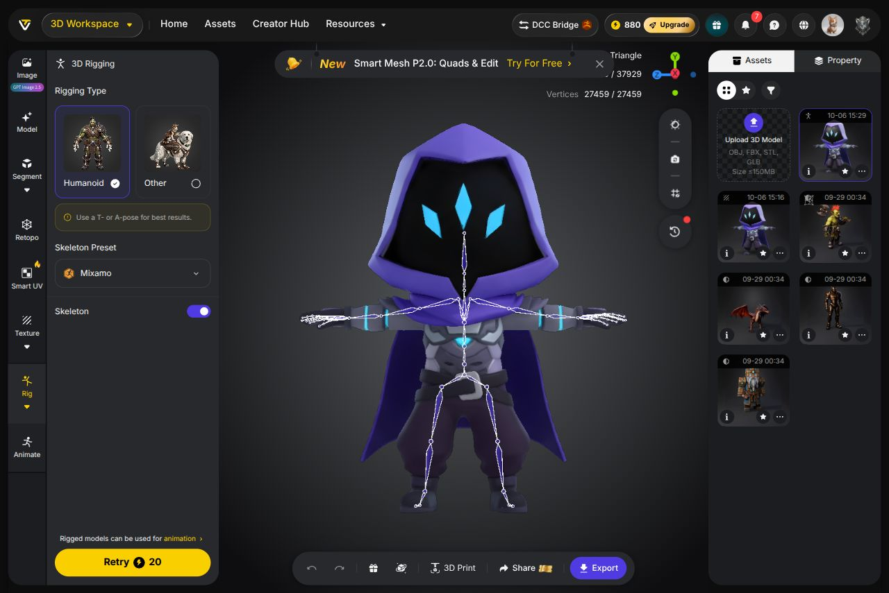
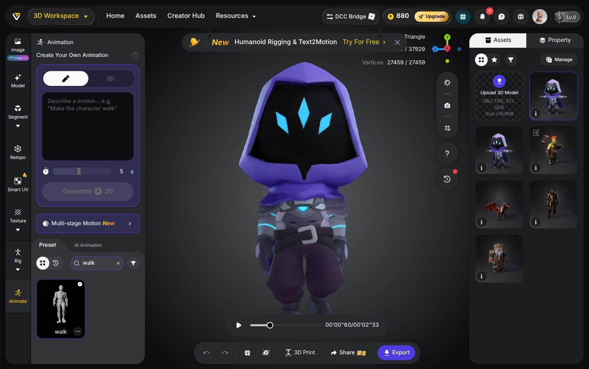
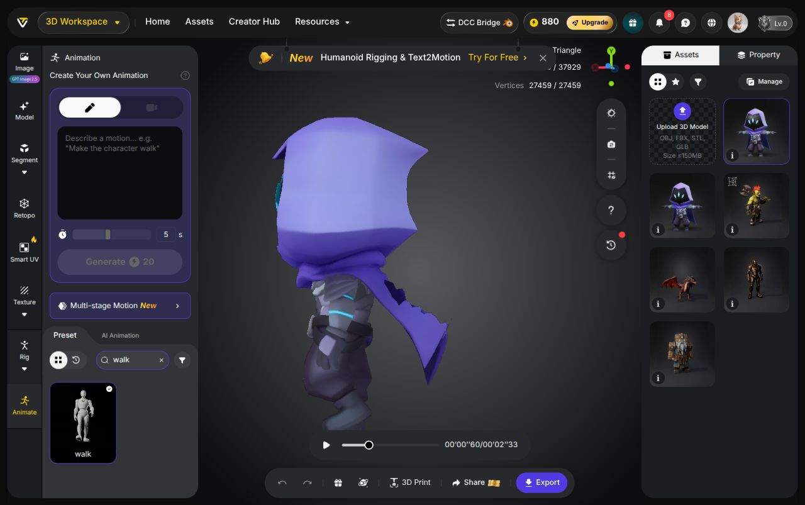

# Karakter chibi bertekstur dan rig humanoid

Selesai pada 6 Oktober 2026: karakter dari referensi video sudah dibuat, diberi tekstur 2K, dioptimalkan, dan di-rig menggunakan skeleton Mixamo. GLB akhir berisi 37.929 segitiga, 27.534 vertex, satu tekstur 2048 × 2048, satu skin, serta 65 tulang. Pratinjau preset berjalan berhasil di Tripo tanpa tambahan kredit.

[Halaman rig hasil di Tripo](https://studio.tripo3d.ai/workspace/rigging/dc19ac55-24fe-4e1e-8a9c-81f37b3b9b41)

## File hasil

| File | Isi |
| --- | --- |
| `chibi-hooded-rigged.glb` | Model utama, tekstur 2K, skeleton Mixamo dan skin weights; 2,27 MB; tanpa animasi |
| `chibi-hooded-walk-preview.glb` | Model dengan satu contoh animasi `walk` di tempat; 2,34 MB |
| `chibi-hooded-rig-ready.glb` | Salinan ringan sebelum diunggah dan di-rig; 37.963 segitiga; 1,70 MB |
| `chibi-hooded-textured-master.glb` | Master bertekstur sebelum pengurangan polygon; 1.898.207 segitiga; 54,67 MB |
| `chibi-hooded-master.glb` | Master mesh awal tanpa tekstur; 45,56 MB |
| [karakter-t-pose.png](karakter-t-pose.png) | Referensi persiapan rig, 1024 × 1024 |
| [hasil-tripo.json](hasil-tripo.json) | ID aset, biaya, ukuran, checksum, serta batasan |
| [validasi-rig.json](validasi-rig.json) | Pemeriksaan skeleton dan skin weights |
| [validasi-contoh-jalan.json](validasi-contoh-jalan.json) | Pemeriksaan GLB contoh berjalan |
| [validasi-optimasi.json](validasi-optimasi.json) | Perbandingan polygon dan bukti tekstur tidak berubah |

`karakter-tripo-rigged.zip` berisi model rigged, contoh berjalan, referensi, bukti visual dan dokumentasi. Dua master besar serta file rig-ready disimpan terpisah di folder `outputs/` agar paket unduhan ringkas.

## Biaya aktual akun web

| Tahap | Pengaturan | Kredit |
| --- | --- | ---: |
| Gambar T-pose | Nano Banana, 1:1, satu gambar, 4K nonaktif, tiga frame video | 10 |
| Mesh sumber | H3.1 Best Quality, Ultra Mesh, Triangle, target 2.000.000, Texture nonaktif | 30 |
| Tekstur | Referensi hasil T-pose, 2K, style None | 10 |
| Optimasi lokal dan impor | glTF Transform, UV asli dipertahankan | 0 |
| Rig | Humanoid, skeleton Mixamo | 20 |
| Preview preset dan ekspor | `walk`, GLB, Export Skeleton aktif, satu animasi, stay in place | 0 |
| **Total** | **Saldo awal 950; saldo akhir terlihat 880** | **70** |

Mesh sumber melewati batas polygon auto-rig Tripo. Salinan lokal dikurangi menjadi sekitar 38 ribu segitiga, kemudian diunggah sebagai aset baru. Retopology berbayar 40 kredit tidak dijalankan. Tekstur 2K pada file hasil optimasi identik secara byte dengan master; UV tetap ada. Saat impor, rotasi Y diatur 90 derajat agar karakter menghadap depan dan Use Original UV diaktifkan. Tripo membersihkan sejumlah segitiga saat impor sehingga hasil akhir berisi 37.929 segitiga.

ID model sumber: `bd91c2ff-492a-47d7-a928-b058a8d4f85b`. ID aset ringan dan rigged: `dc19ac55-24fe-4e1e-8a9c-81f37b3b9b41`.

## Pemeriksaan dan batasan

- File utama dan contoh berjalan adalah GLB v2 yang valid. Validator glTF melaporkan nol error; satu warning `NODE_SKINNED_MESH_NON_ROOT` berasal dari mesh yang menjadi child Armature. Parent Armature memiliki transform identitas. Penempatan dan animasi di engine tujuan belum diuji.
- Seluruh 27.534 vertex memiliki skin weights yang finite, nonnegatif, dan ternormalisasi. Tidak ada vertex tanpa bobot atau indeks joint di luar skeleton.
- Skeleton terlihat pada halaman Rig. Pratinjau berjalan diperiksa dari depan dan samping. Tubuh bergerak, tetapi jubah menghasilkan lipatan yang kurang rapi dari samping; penyesuaian weights atau rig khusus jubah diperlukan untuk hasil gerak yang lebih halus.
- Desain mempertahankan hood/jubah ungu, wajah hitam dengan tiga tanda cyan, armor abu-abu, celana baggy, sabuk, serta boots. Detail jubah belakang dan detail kecil masih dapat berbeda dari video. Kemiripan 100% belum tercapai.
- Hasil ini merupakan rig humanoid otomatis. Cloth simulation, rig wajah, dan gerakan persis seperti video belum dibuat.







## Referensi video

Video berdurasi 40,53 detik. Frame asli digunakan sebagai referensi desain:

- [Depan, 2,53 detik](referensi/depan.png).
- [Belakang, 27,86 detik](referensi/belakang.png).
- [Samping, 17,73 detik](referensi/samping.png); sudut ini tidak benar-benar ortografis.

## Prompt gambar persiapan rig

```text
Use the supplied video frames as identity references for ONE identical chibi hooded character. Preserve the original oversized angular purple hood, pitch-black faceless head with EXACTLY THREE bright cyan tapered vertical slits, purple scarf and pointed purple cape, dark gray segmented tactical chest armor with cyan accents, black gloves, belt with silver buckle, baggy dark navy pants and short dark boots. Match the reference's head-to-body ratio, silhouette, colors, armor shapes and cape length; do not redesign. Produce a single full-body FRONT view in a strict symmetric T-POSE: arms straight out sideways at shoulder height, elbows straight, hands visible and separate from torso, legs slightly apart, both feet fully visible. Keep the cape behind the body and leave the arms and hands unobstructed. Clean stylized 3D game-character render, simple neutral light-gray background, even diffuse lighting, no cast shadow, no environment, no weapons, no pedestal, no text, no extra characters. Do not add human facial features, nose, mouth or extra glowing eyes. Show only one view in this image; use the rear and side references only to preserve the same costume.
```

## Mengulang optimasi lokal

Jalankan dari direktori `work/`. Master tetap disimpan terpisah. Perintah ini tidak menggunakan kredit Tripo.

```sh
bun x @gltf-transform/cli@4.5.1 weld ../outputs/chibi-hooded-textured-master.glb textured-welded.glb
bun x @gltf-transform/cli@4.5.1 simplify textured-welded.glb ../outputs/chibi-hooded-rig-ready.glb --ratio 0.02 --error 0.005
bun x @gltf-transform/cli@4.5.1 validate ../outputs/chibi-hooded-rig-ready.glb
```

[Dokumentasi resmi glTF Transform CLI](https://gltf-transform.dev/cli) menjelaskan `weld`, `simplify`, dan `validate`. [Panduan Tripo tentang preset dan ekspor](https://www.tripo3d.ai/blog/apply-preset-animations-to-3d-character) menjelaskan pemeriksaan gerakan dan ekspor skeleton/animasi. Harga aktual pada tabel berasal dari UI akun Studio, bukan harga API.
